# 4.6 期刊

**3B Journal**

* 出版：Owens-Liang Publications, Ltd.

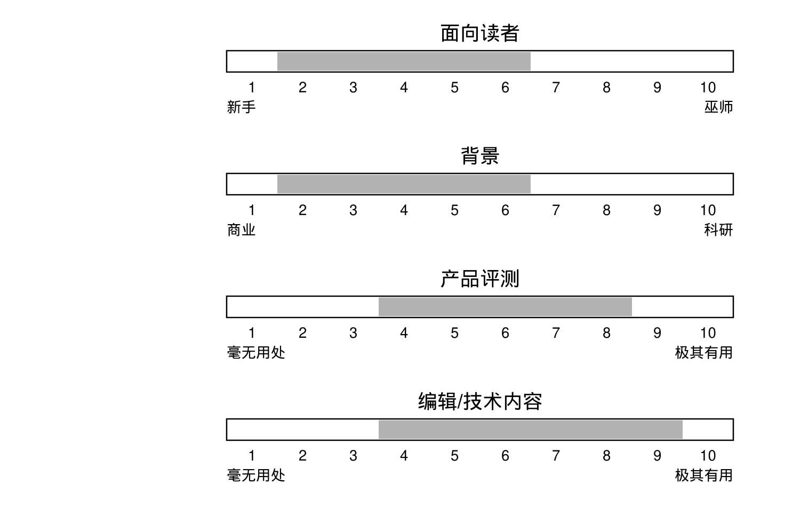

**图 4-31　四项评分：面向读者 2–6、背景 2–6、产品评测 4–8、编辑/技术内容 4–9**

3B Journal 专攻 AT&T 的 3B 系列计算机，刊登产品评测、bug 报告与修复。3BJ 的内容从初学者到 UNIX 大师都能看。

**The C Users Journal**

* 出版：R&D Publications Inc.

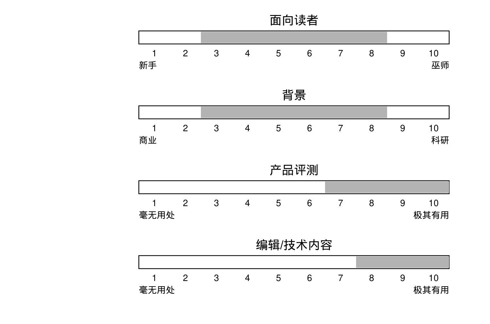

**图 4-32　四项评分：面向读者 3–8、背景 3–8、产品评测 7–10、编辑/技术内容 8–10**

《The C Users Journal》内容如其名，多数文章面向中级 C 程序员，也有相当数量的技术材料报道 C 标准委员会的持续工作。CUJ 尤其值得一提的是它提供了大量公有领域软件。

**Computing Systems – The Journal of the USENIX Association**

* 出版：加州大学出版社（University of California Press）

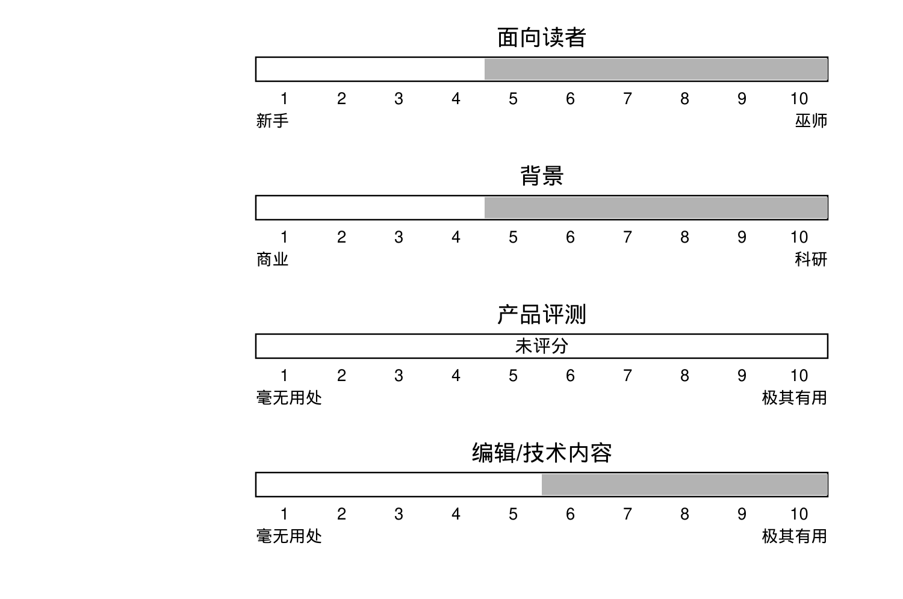

**图 4-33　四项评分：面向读者 5–10、背景 5–10、产品评测 未评分、编辑/技术内容 6–10**

这份季刊专门刊载涉及 UNIX 或基于 UNIX 思想的高级计算系统的研究、实现与分析文章。论文兼顾理论与实践。

**CommUNIXations**

* 出版：/usr/group

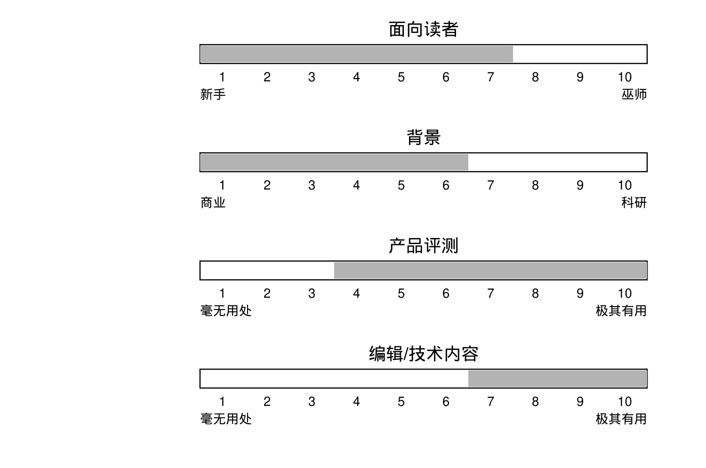

**图 4-34　四项评分：面向读者 1–7、背景 1–6、产品评测 4–10、编辑/技术内容 7–10**

这是 /usr/group 的月度通讯，报道该组织的活动，每月刊登若干篇面向商业的论文，实际上填补了两次 UniForum 会议之间的空当。在这方面，它可以和商业 UNIX 杂志相比，只不过你成为 /usr/group 会员后就能免费收到。

**;login:**

* 出版：USENIX Association

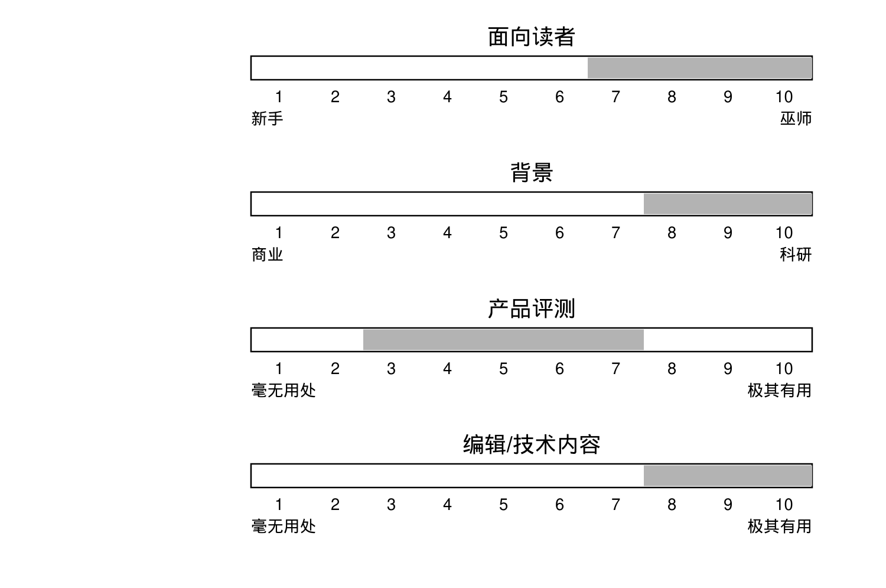

**图 4-35　四项评分：面向读者 7–10、背景 8–10、产品评测 3–7、编辑/技术内容 8–10**

这是 USENIX 协会的月度通讯，也是定期出版的历史最悠久的 UNIX 刊物之一。除了报道 USENIX 的活动，;login: 每月还刊登若干技术论文，实际上填补了两次 USENIX 会议之间的空当。USENIX 协会会员免费获赠。

**Patricia Seybold’s UNIX in the Office**

* 出版：Patricia Seybold’s Office Computing Group

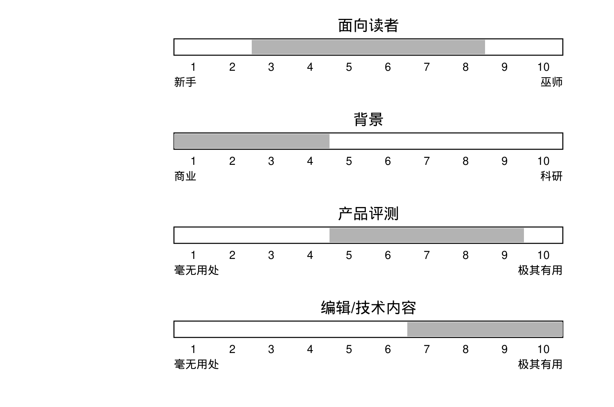

**图 4-36　四项评分：面向读者 3–8、背景 1–4、产品评测 5–9、编辑/技术内容 7–10**

这份通讯专讲办公环境中的 UNIX，内容包括产品评测、趋势分析，以及一些极其专业、深入的分析。非常贵。

**UNIGRAM • X**

* 出版：Miller Freeman Publications

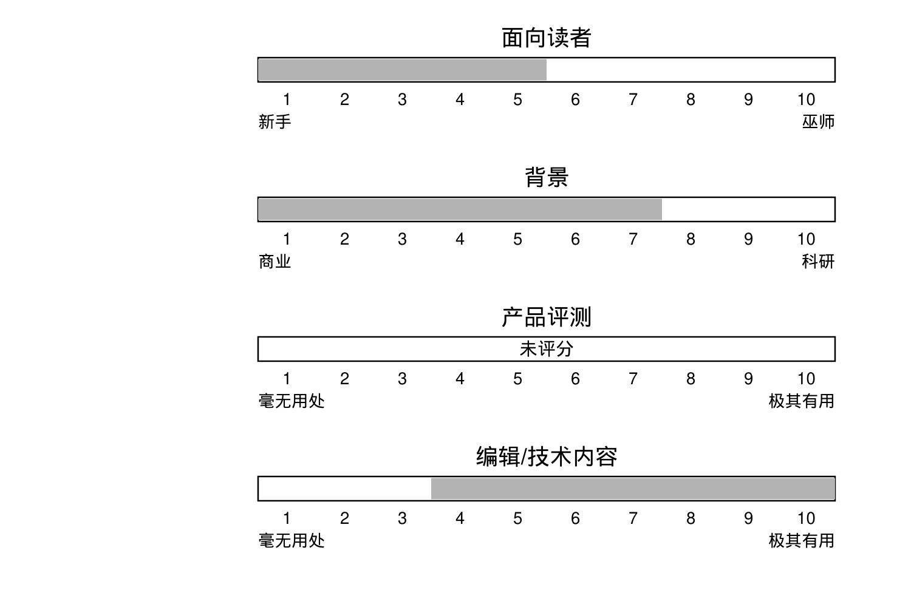

**图 4-37　四项评分：面向读者 1–5、背景 1–7、产品评测 未评分、编辑/技术内容 4–10**

唯一一份每周出版的 UNIX 通讯。内容偏市场：新产品、并购、大合同、联合营销协议、公司分析、市场趋势等等。非常贵。

**UNIQUE**

* 出版：InfoPro Systems

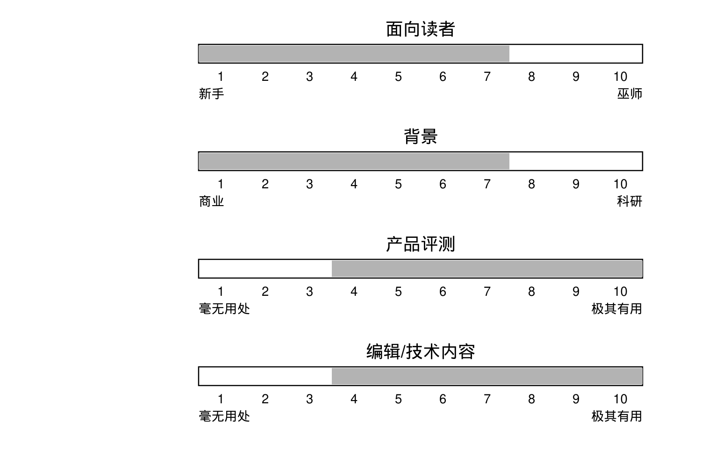

**图 4-38　四项评分：面向读者 1–7、背景 1–7、产品评测 4–10、编辑/技术内容 4–10**

月度通讯，每期刊登少量深度分析，主题从技术问题、产品评测到市场趋势都有。文风有些轻快，但脚踏实地。

**UNIX Products Directory**

* 出版：/usr/group

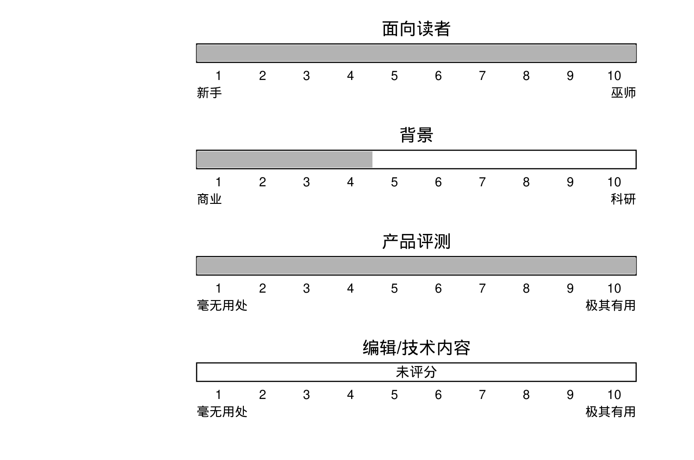

**图 4-39　四项评分：面向读者 1–10、背景 1–4、产品评测 1–10、编辑/技术内容 未评分**

这本厚书每年更新，收录当前所有商业 UNIX 产品的名录，不仅包括硬件和软件，还有出版物和服务。全书 600 页，产品说明只能压到一段话；遗憾的是，大多数说明都是厂商自己写的。

**UNIX REVIEW**

* 出版：Miller Freeman Publications Co.

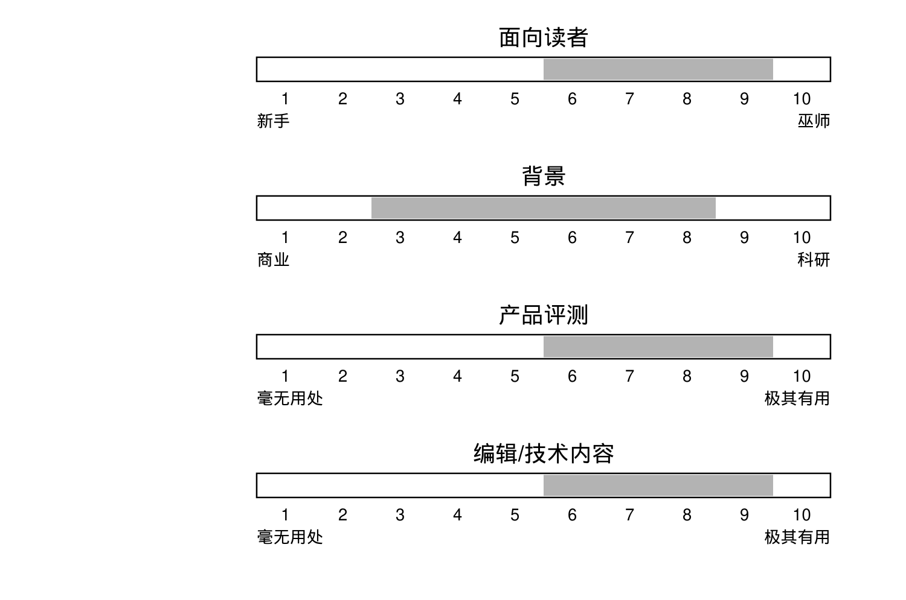

**图 4-40　四项评分：面向读者 6–9、背景 3–8、产品评测 6–9、编辑/技术内容 6–9**

这本月刊面向 UNIX 程序员/黑客，而不是管理者或商业产品的买卖双方。它报道编程以及对程序员重要的内容；软硬件评测聚焦于能集成进系统的产品，而非整机系统。每期都有一篇对某位对 UNIX 产生过重大影响的人物的精彩访谈，常设专栏也很棒，包括 Eric Allman 与 Ken Arnold 的“C Advisor”，以及 Glenn Groenewold 的“Rules of the Game”。

**UNIXuser**

* 出版：Marvin L. Rosenfeld

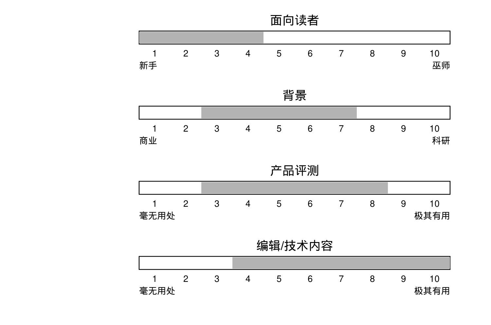

**图 4-41　四项评分：面向读者 1–4、背景 3–7、产品评测 3–8、编辑/技术内容 4–10**

这本杂志面向 UNIX 新手，主题介绍和教程比别的杂志多，产品评测面向首次购买者。它正视了一个事实：大多数 UNIX 用户对 UNIX 知之甚少。

**UNIXWORLD**

* 出版：Tech Valley Publishing

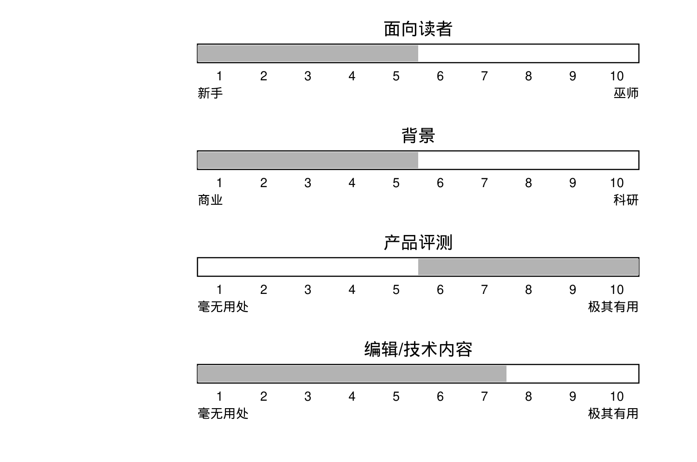

**图 4-42　四项评分：面向读者 1–5、背景 1–5、产品评测 6–10、编辑/技术内容 1–7**

这本月刊面向 UNIX 用户、采购者和管理者，报道市场与技术趋势、应用、评测以及有限的技术文章；产品评测侧重整机或打包的计算机系统。常设专栏很好，包括 Omri Serlin 的“Inside Edge”、Wendy Rauch-Hindin 的“The Hindin Report”，以及“客座”随笔。

**USENIX Conference Proceedings**

* 出版：USENIX Association

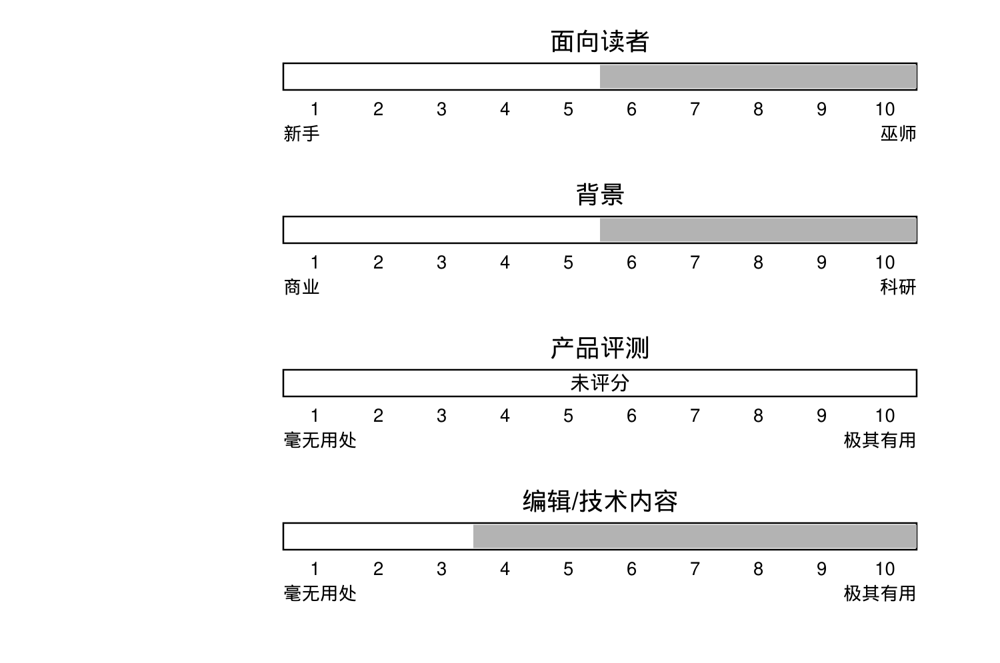

**图 4-43　四项评分：面向读者 6–10、背景 6–10、产品评测 未评分、编辑/技术内容 4–10**

这是每届 USENIX 会议所发表论文的合集。论文通常偏技术，从实用到前沿研究都有。许多 UNIX 奠基性论文最先在这里出现。

**UNIX Bulletins**

* 出版：国际数据公司（International Data Corporation）

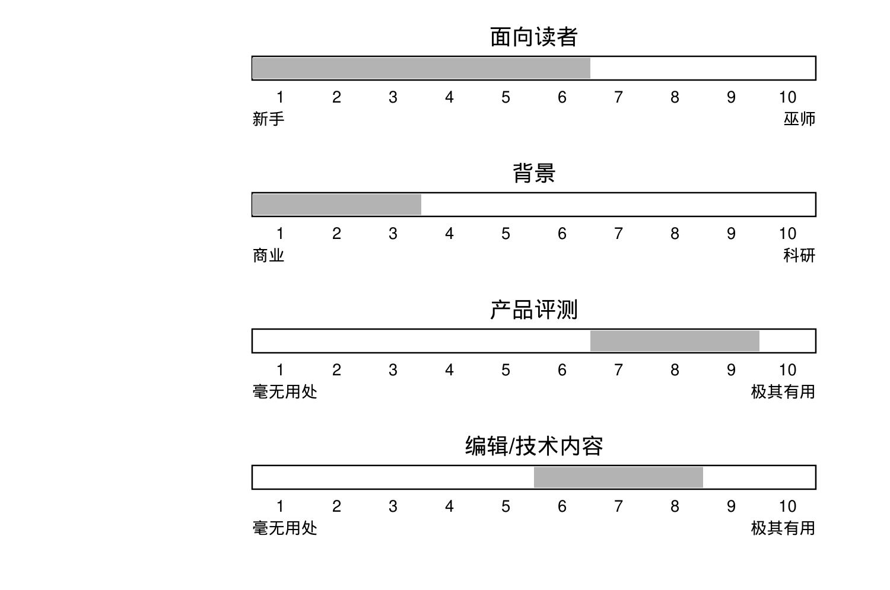

**图 4-44　四项评分：面向读者 1–6、背景 1–3、产品评测 7–9、编辑/技术内容 6–8**

《UNIX Bulletins》每月出版两期，每期深入聚焦一个主题，如标准、趋势或新产品信息，必要时附上技术分析。

**/usr/digest**

* 出版：/usr/group

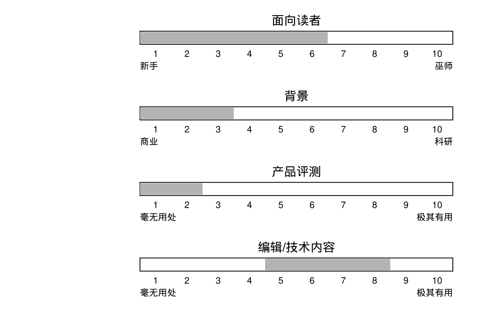

**图 4-45　四项评分：面向读者 1–6、背景 1–3、产品评测 1–2、编辑/技术内容 5–8**

一份半月刊新闻摘要，主要由标题加一段式简讯组成，是 /usr/group 的 CommUNIXations 的好补充。
