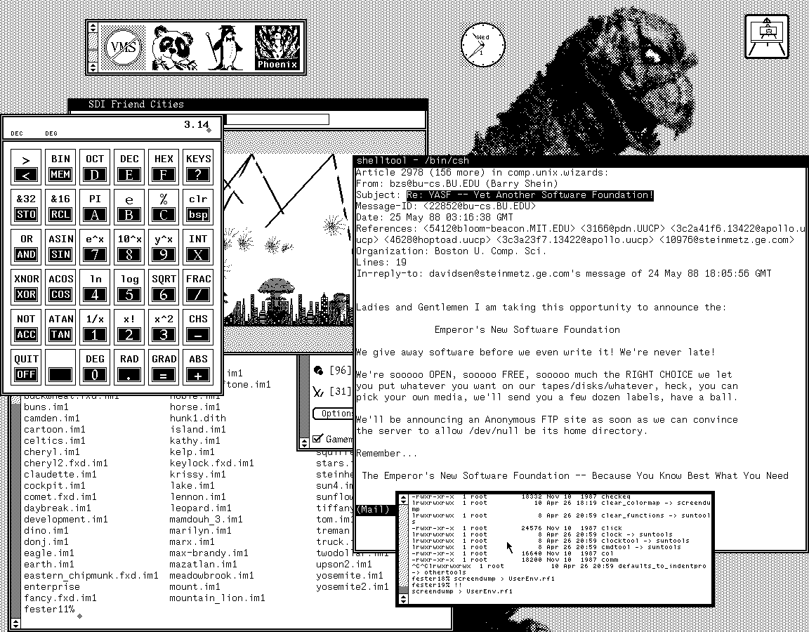

# 6.2 shell 基础

所有 shell 都有许多共同的基本特征，本章余下部分会简要介绍。我们没法为其中任何一个 shell 提供完整的教程和参考——更别提所有 shell 了——但你读完之后，应该能掌握以下内容的实用知识：

* 一些基本的 shell 命令与特性；
* shell 为什么有用；
* 它凭什么胜过大多数其他操作系统的界面。

先打发掉最简单的部分。shell 会提示你输入命令，这里的提示符是百分号：

```sh
%
```

如果你敲下“date”这个词，shell 就会执行同名程序，打印出当前日期和时间：

```sh
% date
Tue Dec 1 17:38:30 EST 1987
```

另一个命令是 cat。cat 把指定文件的内容打印到终端。cat 和 date 都是产生标准输出（C 程序里写作 stdout）的程序，意思是默认情况下它们的输出出现在终端上。许多命令接受标准输入（stdin），意思是默认从终端读取。任何数据流都叫**流**（stream），所以你会听到有人把 stdin 称作“输入流”，把 stdout 称作“输出流”。

## 6.2.1 I/O 重定向

stdin 和 stdout 本身没什么稀奇，但 shell 让我们能轻松重定向它们。比如，下面这条命令能把 date 命令的输出存进 old-date 文件：

```sh
date > old-date
```

命令执行时，输入或输出可以被重定向到各种地方。所有 UNIX 程序都懂 stdin、stdout、stderr（标准错误）这一套。有了 stderr，你重定向命令输出时就不会把错误信息一并弄丢。

任何程序的 stdout 都能接进另一个程序的 stdin。令人惊讶的是，大量程序都能轻松利用这层抽象，写这样的程序也很容易。

I/O 重定向由 shell 提供，用户程序不必自己操心。几种基本的重定向如下：

| 写法 | 含义 |
| ---- | ---- |
| `< file` | 用 file 作标准输入。 |
| `> file` | 用 file 作标准输出。 |
| `>> file` | 用 file 作标准输出；若文件已存在，则追加。 |
| `<< string` | 持续读取当前标准输入，直到遇到只含 string 的一行或文件结束（EOF）。 |
| `` `command` `` | 执行 command，并用它的标准输出替换命令替换处。 |

下面是几个例子。下面这句把 ls 命令的输出记录到名为 dircontents 的文件里：

```sh
% ls > dircontents
```

由于 cat 把标准输入送到标准输出，我们可以让 cat 把 dircontents 当作标准输入，从而把它打印出来。不重定向 cat 的输出，我们就能在终端上看到它：

```sh
% cat < dircontents
```

最后一种重定向叫命令替换，也叫反引号替换。它让命令的输出变成待执行的新命令或参数：

```sh
% echo date
date
% echo `date`
Mon Feb 1 08:04:28 EST 1988
```

## 6.2.2 管道

管道把一个进程的标准输出接到另一个进程的标准输入。你可以把它看成另一种重定向。要建立管道，把两条命令写出来，中间夹一个 |（我们自然管它叫管道符号）。

比如，把 ls 的输出接进一个字数统计程序的输入，就能数出文件个数。（wc 统计词数等等；`wc -w` 只打印词数。）

```sh
% ls | wc -w
5
```

很方便吧？把 ls 接给 sort 命令，就能给目录排序（虽说 ls 本来就能排）。wc 可不懂什么文件，它只会数东西。比如，用 grep（按特定模式搜索字符串），你可以数出字典里匹配某个模式的词有多少个。

先看看 grep 如何在 **/usr/dict/words** 里搜索包含“sue”一词的词：

```sh
% cat /usr/dict/words | grep sue
desuetude
ensue
issue
pursue
pursuer
sue
suey
tissue
```

再用 wc 数一数有多少个：

```sh
% cat /usr/dict/words | grep sue | wc -w
9
```

注意我们是怎么把若干命令的输出拿来当作另一些命令的输入的。你可以构造任意复杂度的管道。把非常简单的程序组合起来，就能造出有用的命令；用原作者做梦都想不到的方式来使用现成程序，也毫不费力。

## 6.2.3 shell 脚本

经常重复的命令可以存进文件，这样只要敲文件名就能重跑复杂命令。一串命令也能存进单个文件。存放 shell 命令的文件叫 shell 脚本，可以像任何其他命令一样调用。（如果脚本里的命令使用 stdin、stdout，它们照用不误。）于是，你的环境能非常容易地扩展和定制。

shell 脚本很像现代编程语言的程序。事实上，shell 提供了控制结构，高级编程语言里能写的东西，它几乎都能写。shell 支持 if-then-else 语句、do 循环和变量。

许多人发现自己除了 shell 几乎不用别的语言——它就有这么强，而且好用。最妙的是，无论写脚本还是直接敲命令，shell 的语法完全一样。

当然，不同 shell 做法不同，所以最好在脚本开头声明你用的是哪个 shell。（管理员一章会讨论一种标准的写法。）如果你发现某个 shell 脚本需要跑得更快，有几招可用：一是找出脚本里慢在哪儿（通常只有一两行造成大部分瓶颈），然后重写那几行，或用别的语言（比如 C）专门写程序替换它们。我们发现需要重写的行很少超过两三行（大多数 UNIX 程序本来就够高效）。另一条路是弄一个 shell 编译器，这在讲应用的章节里有讨论。

本章最后一节“综合运用”还有更多 shell 脚本示例。讲现状的那一章也谈了更多关于 shell 编程的哲学。

> **shell 示例：增量归档**
>
> 许多用户喜欢用归档程序 cpio 备份自己的文件。但 cpio 没法只保存最近改动过的文件。而 find 程序能找出若干天内改动过的文件。把 cpio 和 find 这两个本来不相干的 UNIX 命令组合起来，我们就能造出一个生成增量归档的新程序。我们管它叫 incarc。（把下面三行代码放进名为 incarc 的文件，然后用 chmod 把它标为可执行。）
>
> ```sh
> find $1 -mtime -$2 -type f -print > $HOME/incarc.tmp
> cat $HOME/incarc.tmp | cpio -ocBv > /dev/tape
> rm $HOME/incarc.tmp
> ```
>
> 执行时敲 `incarc 目录 天数`，其中“目录”是要保存的目录，“天数”是保存最近多少天内改动过的文件。
>
> 第一行用 find 找出所有符合条件的文件。（find 的更多内容见本章后文。）第一个和第二个参数分别用 `$1`、`$2` 取到。文件名被存进主目录下名为 incarc.tmp 的文件；下一行把归档写到磁带上。注意，归档程序从标准输入读取、向标准输出写入。
>
> 最后一行删掉我们用来暂存文件名的那个文件。有兴趣的话，试着改写这个脚本，让它不用临时文件。再进一步，研究一下 find，把 incarc 改造成能自己判断该转储多少天以内的文件。（提示：`-newer`。）

## 6.2.4 别名

> “法语里伦敦就叫巴黎。”——Eugène Ionesco

大多数 shell 都提供别名的概念。别名就像 shell 脚本，只是不存在文件里，而是存在 shell 的工作内存里，适合单行命令。比如，如果你经常敲 `ls -lt`，可以把它别名成单个字符 `l`，能省下大量击键。真要较真的话，你还可以把 ls 别名成“list”或者“directory”，或者你觉得它该叫的任何名字。

```sh
% alias l ls -lt
```

虽然别名通常用于单行命令，但它们也可以相当复杂，能力与 shell 脚本大体相当。

## 6.2.5 环境变量

和任何编程语言一样，shell 也有变量，用法完全一样。有几个变量是 shell 预定义的。比如 prompt 变量保存用于提示用户的字符串。许多人喜欢让提示符反映当前目录，也有人喜欢“好玩”的提示符。比如下面这招在 csh 里管用：

```sh
/usr/libes/src/pacman% set prompt = "Yes, master? "
Yes, master? date
Tue Dec 1 17:38:30 EST 1987
Yes, master?
```

除了 shell 本身，许多程序也利用 shell 变量来传递信息。比如，那些要用字符图形编辑器的程序（如邮件程序）并不自己提供编辑器，而是调用用户喜欢的那个。怎么做到？邮件程序会查看 EDITOR 变量的值；如果它被设成某个程序名（如 emacs、vi），就运行那个编辑器。这给用户一个熟悉的环境，也让邮件程序省得自己重复实现编辑器功能。

这些变量（以及前面讲的别名）虽然可以交互式设置，但通常写在登录时读取的特殊文件里（如 .login、.profile），或者在每次启动新 shell 时读取的文件里（如 .cshrc）。

## 6.2.6 进程控制

UNIX 是多任务操作系统（你也会听到“多进程操作系统”的说法），意思是它能同时执行多项任务。你的 shell 只是其中一项；此外还有许多进程在替系统不停地跑。前面见到的管道，就是同时启动多个任务执行的例子。

你可能从没同时跑过一条以上的命令，但那就太反常了。大多数人一直在同时运行好几个进程：一个进程在跑，人已经在为下一个进程敲命令了。毕竟，要是每敲一条命令都干坐着等它跑完，你会把大量时间浪费在发呆上。

这就引出一个有趣的问题：怎么控制这么多进程？早期 UNIX 的进程控制机制非常简单。你可能已经注意到，敲下 grep 这类简单命令后，shell 要等命令执行完才提示你输入下一条。这叫同步执行。如果在命令末尾加一个 & 符号，它就会异步执行（或者说在后台运行），shell 不会等它结束就让你干别的事。

后台可以有任意多个进程在跑，但前台同时只能有一个。前台进程就是接收你从终端敲入字符的那个。要是有不止一个前台进程，就没法判断你的击键该送给谁了。

早期 UNIX 界面的一个大问题是：你没法把进程在前台和后台之间来回搬。比如，你正在前台编辑文件，想用 cat 看一眼另一个文件再回来接着编辑——做不到。你只能退出编辑器、运行 cat，再重新启动编辑器。

最初，交互式的 UNIX 程序很少，所以把前台进程挪到后台（反之亦然）的需求不大；前台命令也很少能持续到值得打断。编辑器就是这少数命令之一。于是有了一个特殊命令（“!”），用来在不退出编辑器的情况下执行别的命令。这种转义命令后来在别的长时间运行的交互式程序（如 tip、cu、adb、vi）里也流行起来，它们至今沿用 ed 的原始语法。

再后来，交互式 UNIX 程序越来越多，对更精巧进程控制的需求随之而来。现代 UNIX 系统里有好几种进程控制机制，其中两种特别流行——作业控制和窗口。

**作业控制**

伯克利的 C shell 是第一个使用作业控制的 shell。作业控制是 UNIX 系统提供的机制，用来挂起和恢复进程、把物理终端连接或断开进程的 stdin 与 stdout。C shell 把作业控制包装成一个在前后台之间切换进程的极简系统：它保留了几个控制字符，随时可输入它们来挂起前台进程并回到 shell。一旦回到 shell，你就能用一套丰富的命令摆布后台进程；其中自然有一条命令把后台进程调回前台。

作业控制的一个缺点是，应用程序可能想用那些已经分配给作业控制的字符；另一个缺点是，作业控制（具体说是伯克利的实现）在挂起进程时不会保存进程的全部状态——比如物理屏幕就不保存。对图形应用来说，这可能是致命的。最终结果是：某些应用必须自己感知作业控制，才能让作业控制看起来真的对所有进程都有效。尽管作业控制并非对所有应用都完全透明，它还是极受欢迎，因为它对大多数应用都管用。

伯克利引入作业控制的同时，AT&T 推出了 shell 层（shell layers）。它比简单的重定向提供更好的 I/O 控制，并间接由此实现了一种粗糙的作业控制——比如，你可以给某个进程发信号，让它一旦准备好接收输入就来到前台。这套机制如今已基本消失，而伯克利的作业控制几乎在所有系统上都得到支持，无论它们跑不跑伯克利 UNIX。带“伯克利增强”的 System V 机器通常都包含带作业控制的 csh。

**窗口**

在单块屏幕上同时显示多个会话是可行的：物理屏幕被逻辑地分割成若干窗口，每个窗口控制一个不同的程序。与只有一个前台进程的作业控制不同，窗口允许任意多个进程在前台运行。换句话说，每个窗口里的进程都是前台的。

用户通常用鼠标之类的指点设备来操作窗口本身。当然，窗口也有和作业控制一样的毛病：应用程序可能想接收那些已经被窗口控制占用的鼠标动作。看起来没法摆脱这个“元控制”难题。

尽管如此，窗口还是很受欢迎。想象一下，调试器、编辑器、编译器和手册各占一个窗口，开发程序是什么光景。唯一真正的缺点在于，显示窗口的高质量设备比普通字符图形终端更费钱、更耗 CPU 时间。



同时使用窗口和作业控制是可能的。怎么做到？在一个窗口里运行 shell，你就能用作业控制把好几个程序放到后台跑（而且还能使用 ed 等程序里依然存在的旧式转义命令！）。还可以用作业控制挂起窗口管理器本身，从而挂起整套窗口——有点像从这张桌子起身挪到另一张桌子。

各种窗口系统的参考资料见讲应用的章节。
