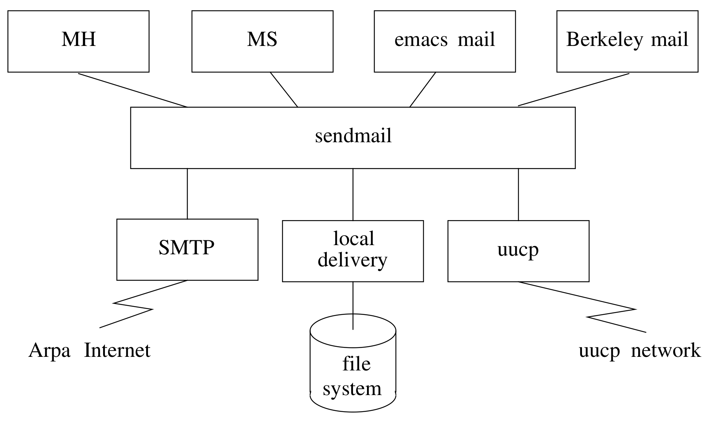

# 11.12 邮件与消息传递

> “如何一天处理 200 条消息，还能干点正事”——Marshall Rose 与 John Romine 关于 Rand 消息处理系统的演讲题目

现代电子邮件系统通常分三部分实现。最上层是用户界面（或称用户代理）。和 shell 一样，用户喜欢自己写邮件界面，因此这类界面多得很，你的系统上很可能就不止一个（尽管 **/bin/mail** 总是有的）。

最下层是传输机制，负责实际投递邮件；不同的网络和计算机必然用不同的机制。比如，Arpa/Internet 邮件用 SMTP，串行线相连的主机之间用 uucp。邮件传输机制通常与文件传输机制密切相关。

剩下的中间部分是粘合剂，把上下两半连起来。它其实只是个路由器，却被迫承担所有没人想解决的苦活。问题在于，大多数邮件系统使用完全不同的地址格式，总得有个东西来做转换。

**图 11-2　典型 UNIX 邮件系统：用户界面、sendmail 与投递程序**

流行的邮件路由器有 sendmail 和 MMDF。关于电子邮件的好文章有 D. Crocker 等人的《An Internetwork Memo Distribution Facility – MMDF》（第 6 届数据通信研讨会，Asilomar，1979 年 11 月），以及 Eric Allman 的《Sendmail – An Internetwork Mail Router》（《4.2BSD UNIX Programmer’s Manual》第 2C 卷，加州大学伯克利分校，1983 年 7 月）。

早期 UNIX 版本就有许多邮件系统，但新的无疑好得多：它们支持多个网络、能与异构邮件系统对接，而且往往是图形化或菜单式的，许多还与办公自动化软件捆绑、深度集成。

一些邮件系统有 Calem（AT&T IS）、EuroText（Asicom, S.A.）、Handshake Colt Computer Linked Telex（SST Data 公司）、INmail（Interactive Systems 公司）、IDesk（英特尔）、Infolink（Clever Connections 公司）、Office Telesystem（AT&T IS）、Q-Mail（Quadratron Systems 公司）、R Desk（R Systems 公司）、RootMail（Root Computers 公司）、Take Notice（V-Systems 公司）、Teletex（TITN 公司）、Twice MHS X.400（TITN 公司）、UNIX PC Electronic Mail（AT&T IS）、VoiceServer（Digital Sound 公司）。
