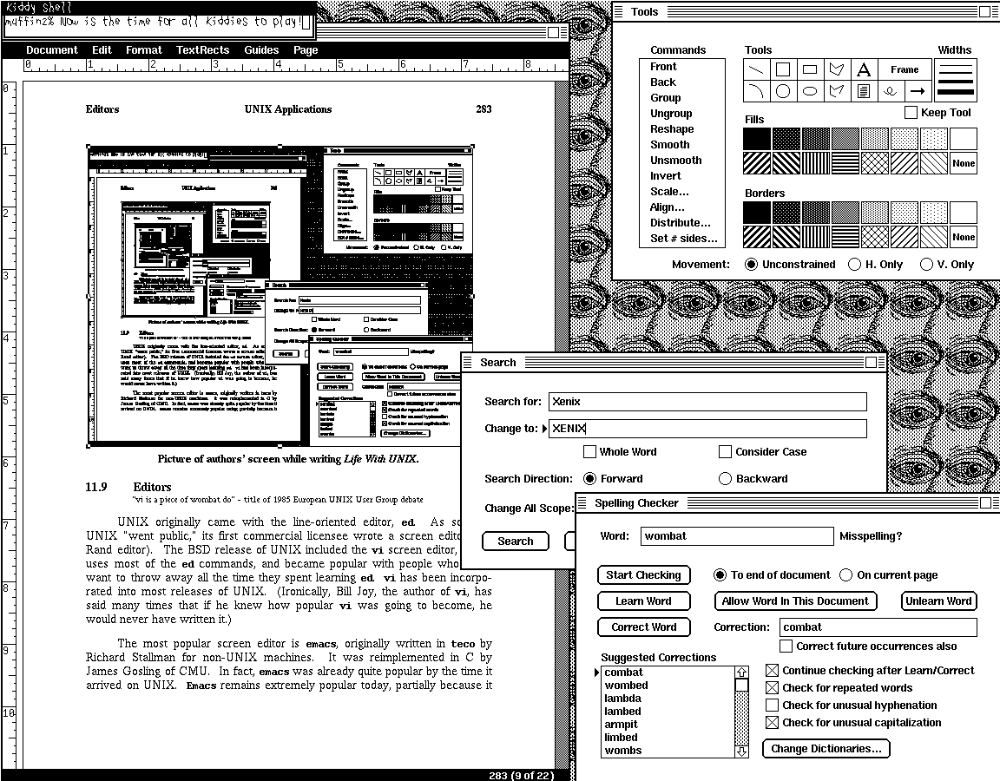

# 11.8 桌面出版

> “为什么 troff 不能更像我的 Mac，而 Mac 又不能更像 troff？”——John Mashey

UNIX 一直带着 troff 和它的伙伴们。贝尔实验室的程序员能用上照相排版机——一种直接产出制版原稿的设备（照相排版机的分辨率通常在 1,000 dpi，即每英寸点数，甚至更高）。因此，UNIX 一直包含这样的接口。可惜对大多数 UNIX 站点来说，照相排版机贵得离谱，动辄 100,000 美元以上。

1975 年前后，照相排版机唯一的替代品是静电打印机。它们质量不如，但仍能做图形，而且便宜得多。可惜还有一堆别的毛病（要专用纸、输出得剪开等等）。不过，在买不起照相排版机、又想用 UNIX 那套可爱文字处理工具的 UNIX 站点上，它们相当常见。

到 1980 年，激光打印机的价格已降到照相排版机的零头，很快就被接到 troff 这类程序上。四年后，一台 300 dpi 激光打印机不到 10,000 美元，比菊花轮打印机更受欢迎。（菊花轮打印机便宜——约 3,000 美元——输出质量高，但缺少软件字体控制和图形能力。）

激光打印机虽比不上照相排版机的质量，却能胜任大多数人需要的大部分工作（报告、论文、信件）。（这又是 UNIX 法则的一例：10% 的努力（呃……价格）解决 90% 的问题。）

随着 Macintosh 的问世（它可不跑 UNIX！），Apple 给世界带来了另一种桌面出版。Apple 的愿景是易用、所见即所得（WYSIWYG）的界面——troff 两样都不占。Apple 的产品也比任何同类都便宜得多。

此后，许多公司把这套技术和桌面出版风格从 Mac 搬到了 UNIX 机器上，troff 也随之被一批非常友好的系统取代。比较流行的 UNIX 桌面出版系统有 Interleaf（Interleaf 公司）和 Frame Maker（Frame Technology）。（本书就是用 Frame Maker 做的。）不幸的是，troff 仍是裸 UNIX 唯一分发的出版系统，于是不知情的人还在用它。

诚然，troff 极其灵活，专家能拿它做出惊人的东西；但 troff 之所以根深蒂固，真正的原因是它多年来没有像样的竞争对手。这带来了不幸的后果：有些出版商（如 USENIX）只接受 troff 格式的稿件；有些出版商（如 Prentice-Hall）则把所有其他电子格式都转成 troff。

ditroff 是 troff 的重写版（代表 “device-independent troff”，读作 “dit-roff”）。奇怪的是，troff 为一种特定的排字机（C/A/T，现由 Wang 销售）产生输出，而很少有人有这种机器。要用任何别的输出设备，你得把 troff 的输出通过过滤器，转成设备无关形式；再用另一个过滤器转成你真正需要的格式。ditroff 直接产生设备无关输出，还支持许多 troff 一直做不好的事（比如在一个文档里使用四种以上的字体）。ditroff 由 AT&T 等公司销售。

*作者撰写《UNIX 生活》时的屏幕。*
