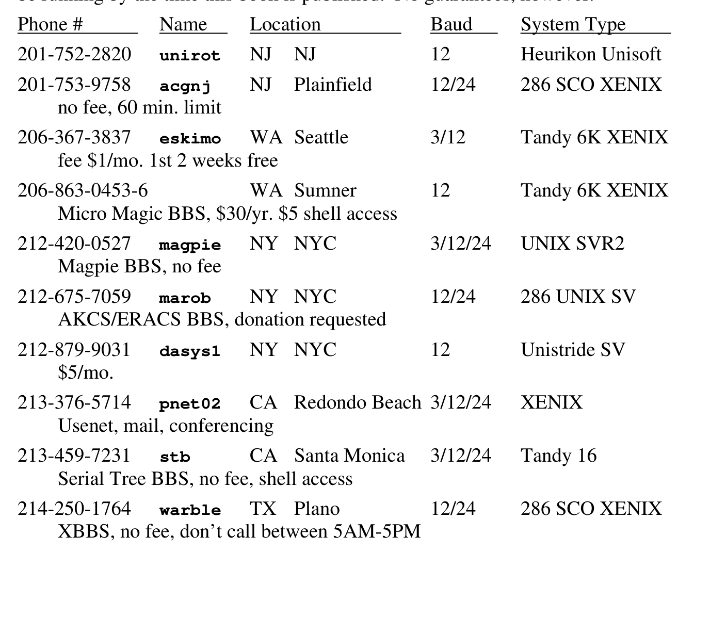
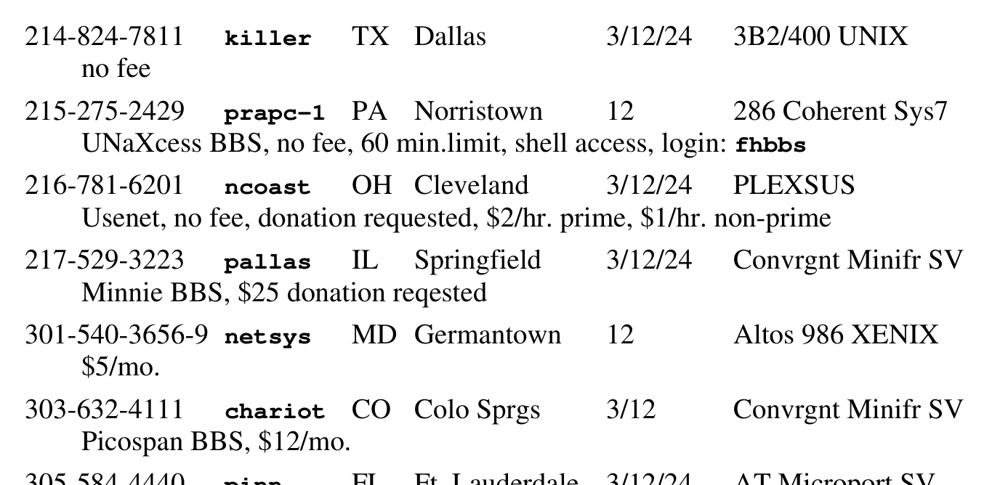

# 9.1 Usenet

Usenet（Users’ network，用户网）是一批计算机，提供集成的网络文件传输、存档服务、邮件、会议和新闻。人们常简称它为“netnews”，甚至只叫“news”。

新闻的工作方式很简单：任何站点（计算机）上的任何人都可以“张贴”新闻；每个站点呼叫最近的邻居，把文章传过去；邻居再传给它们的邻居，如此无穷往复，文章便传遍整个网络。由于大多数机器都连着好几个邻居，这个网络极其健壮。

大多数机器是运行 uucp 软件、以拨号电话线作为底层传输的 UNIX 机器，但也有许多别的机器，通过网关连到其他网络。uucp 链路大多走拨号线。邻居都挑地理上挨得近的，再配上现成的异步调制解调器，传输成本就压得很低。使用 Usenet 不收管理费。

除了便宜，Usenet 与其他网络还有两点不同：1）它的用户中 UNIX 用户占比最高；2）在“某类计算机系统挂在某类网络上”的所有组合里，占比最高的就是挂在 Usenet 上的 UNIX 机器。

可以想象，Usenet 是寻找 UNIX 信息的好地方。不过，这类信息与手册、杂志和书上的截然不同：它带有电子邮件的许多特征，通常不拘形式、充满个人见解，而且大多应时、易逝——这正符合它的投递方式。尽管如此，其中仍有大量有用的材料，还有基准测试、源码清单这类绝不可能出现在其他媒体上的客观内容。

Usenet 从有价值到琐碎到荒唐，一应俱全——而在“网”上翻捡垃圾、淘出真正的宝贝，本身就是乐趣的一部分。（如果你是那种爱翻邻居垃圾桶的人，你会爱上 Usenet。）Usenet 涵盖每个 UNIX 用户感兴趣的话题：不只是 UNIX，还有计算机（嘿，UNIX 就跑在计算机上）、食物（嘿，UNIX 用户都得吃饭）、电影（嘿，我们都看电影）、幽默（读这本书的人总得有点幽默感），以及几乎所有能凑够十个人来聊的话题。

用户可以运行一个叫 postnews 的程序（或许多类似界面之一），把文章（任何文本、程序源码或二进制）张贴到网上。postnews 把文章分发给你事先约定好共享文章的一小批地理上邻近的计算机；他们再转发给自己的邻居。分发是双向的，所以在你的文章传出去的同时，你的系统也会收到其他站点张贴的新文章。

你不必在传输时就读，它们作为文件存在你的系统上，你有空再看。浏览文章可以用多种程序，流行的有 rn（read news）、vnews（visual news）和 notes。每种都有一批拥趸；rn 似乎最精巧，但 vnews 用得最多，因为它随新闻软件捆绑，别的没有。还有 emacs 这类程序提供的界面（它似乎给什么都配了接口）。

文章以文件形式存放，你当然也能用 cat、ls 这类 UNIX 命令去看；可材料实在太多，vnews 之类的程序不可或缺。况且，新闻阅读器还帮你撰写跟进文章，或直接回复原作者；有些能在后一篇是对前一篇的回复时，把两篇并排显示；还有的具备极其精巧的功能，比如按用户定义的模式筛掉（或筛入）文章，或者沿着讨论线索在不同文章间穿行。

从实际意义上说，Usenet 是一套让计算机彼此通信的软件。与分组网或电路网不同，Usenet 是一个逻辑网络：它处理的是文章、主题、跟进等等；物理网络（如 uucp 和 Arpanet）负责底层实际的通信。

最早的网络跑在 uucp 之上（本书别处有介绍），连接杜克大学和北卡罗来纳大学（UNC）的几台计算机。随着越来越多的人共享 UNIX 软件（以及廉价调制解调器日益普及），这套公有领域软件传播开来，更多站点加入了网络。

Usenet 早期，典型的文章大致是这样的：

```sh
From: ucbvax!vax135!allegra!del
Subject: anybody got a hpz29x driver for PDP-11/23?
Newsgroup: net.unix

I am trying to bring up a hpz29x frisbee under V6.  I have never
written a driver before, but I have the source to a driver for a
hpz29q which is pretty similar.

I don't understand the reference to hpregs->zork.

Any hints?

Reply to allegra!del
---------------------------------------------------------
```

这里有个叫 del 的用户，在 allegra 站点上想让一件系统没有驱动的外设跑起来。他找到了一个非常相似设备的驱动，开局不错，但最终还是需要专家帮忙，于是把问题发到了网上。

这类消息通常会引来一串回答：不仅有人解答 del 关于那个引用的疑问，而且总有人早已遇到同样的问题，还会顺手把源码寄给 del。这种互动至今未变。你很难找到一个还没被发现和修复的 bug——而打听到这种事，正是网络最擅长的。

分发驱动、常用程序（尤其是内核）的 bug 修复、故障现象等等，已成惯例，许多 UNIX 公司也这么干。人们还会发表一般性抱怨、新软件、新软件原型、新软件原型的想法，以及烂笑话。

每类文章都带有新闻组标签。新闻组是文章材料的大致分类，让你能索取特定主题的文章（也可以更精确地按标题或关键词索取）。比如 comp.unix 是讨论 UNIX 的新闻组；其他 comp. 新闻组都与计算机有关。笑话则归在 rec.humor（rec 表示娱乐）。活跃的新闻组有数百个，有些渐渐没了声息、就此消亡，新话题一出现，新的组又建起来。rec.humor、comp.unix.bugs 之类的，无疑会永远存在。

统计显示，1987 年初最活跃的十个新闻组（按活跃度排序）是：

| 新闻组 | 内容 |
| ------ | ---- |
| soc.singles | 与单身生活有关的讨论 |
| soc.women | 女性议题讨论 |
| rec.humor | 笑话、打油诗及其他幽默 |
| comp.sys.ibm.pc | 关于 IBM 微机及兼容机的讨论 |
| comp.unix.questions | 与 UNIX 有关的问题 |
| comp.sources | 程序源码 |
| rec.autos | 关于汽车的讨论 |
| misc.consumers | 消费者权益讨论 |
| comp.unix.wizards | 资深 UNIX 用户的讨论 |
| comp.lang.c | C 编程语言讨论 |

没错，就是这样。Usenet 读者最关心的话题是单身问题。根据我们的研究，UNIX 程序员用 Usenet 讨论约会安排的几率，是用它讨论如何实现共享库的三倍。只不过，你要拿这份榜单去说服本地管理层接受 Usenet 时，记得先把前三个新闻组从榜首删掉。

下面还有一些关于 Usenet 的有趣统计。† 各站点每天收到超过 2 MB 文章，平均每周 15.4 MB；每周有 6,760 篇文章（每天 561 篇）；一个月内有 2,552 人张贴了所有这些内容；共有 235 个新闻组；5,300 个站点，估计 157,000 名读者。哇！

> † 这些统计由 Brian Reid 的 Arbitron 系统于 1987 年 1 月生成。这套程序自动收集 Usenet 读者调查数据，每月把结果张贴到 news.list。

除了在 Usenet 上滚滚流动的数据量，还有几点让它独一无二。

**没有中央管理。** 不仅没有中央管理机构，也没有任何个人或团体握有绝对权力。事情似乎靠共识和同侪压力来决定：如果有足够多的人（从来不是全体一致）发邮件或文章表示赞同，某个东西（比如新闻组名）就会被改掉。实际上，只有少数人（大概不到 100 个）真正讨论网络事务并做决定。修改软件并发布补丁，是迫使或鼓励别人改变的另一种方式——当然，人家也可以不听。（正因如此，市面上跑着大约 50 个不同版本的新闻软件。）

**访问是免费的。** 嗯，差不多吧。与商业网络以及 Bitnet、Arpanet 这类受资助的研究网络不同，Usenet 没有任何赞助者：没有雇员，没有简报，没有管理开销。花钱的只有机时和通信费。大多数站点在夜间运行 Usenet 软件——机器闲着，反正 CPU 周期也浪费了；uucp 的电话都在本地通话区内拨打，通常免费。有些站点为了建立本来不可能的连接，确实自掏腰包支付国际线路费用。对此我们永远心存感激。

虽然 Usenet 没有中央管理，少数站点也能私下把 Usenet 用于选定的一组新闻组。比如许多公司就这么用：它们可以建立自己专属的新闻组，而不必强迫全世界跟着做，张贴到这些新闻组的信息也只留在公司内部的计算机上。

用这种方式，还能建立各种“禁忌”新闻组——出于种种原因，更公开的机器无法支持它们。比如，人们总爱想象有非法毒品供应商在用 Usenet 协调活动和价格。祝你能挤进他们的分发名单。

大多数新闻组不设审核。也就是说，任何人贴的东西大家都看得到。反过来，审核制的新闻组指定一个人（版主）接收所有候选文章（以邮件形式），再由他分发到组里。版主的好处是能砍掉所有无用、重复或不合时宜的材料。有人说审核等于审查，但审核提高了新闻组的质量，同时压低了流量。不过当版主很费时间，所以没多少人干，于是很少有组实行审核。

新闻的文档，主要靠新闻自己的媒介来发布。随分发而来的有几份文件，讲“如何阅读新闻”“如何安装新闻”等。讲张贴礼仪的文件叫《Usenet Etiquette》，它试图说明计算机会议与其他通信媒介有何不同，以及为什么加州的读者不会对“新泽西有人在卖餐桌椅”这种广告感兴趣。

还有许多新闻组专门提供关于网络的最新信息。比如有一个组每月张贴最新的网络地图，另一个组则保存所有新闻组及版主的最新清单。

关于 Usenet，已有大量文章从技术和社会两方面加以论述。John Quarterman 的《Notable Computer Networks》（《Communications of the ACM》第 29 卷第 10 期，1986 年 10 月）出色地把 Usenet 与其他网络作了比较。其他值得一读的还有 Erik Fair 的《A Perspective on the Usenet》（;login: 第 11 卷第 1 期，1986 年 1/2 月）、1987 年冬季 USENIX 会议录中的《News Need Not Be Slow》，以及 Lauren Weinstein 的《Project Stargate》（1985 年夏季 USENIX 会议录）。

## 9.1.1 如何接入 Usenet

接入 Usenet 有几个步骤。

1）与一个已在 Usenet 上的站点建立通信。第一个问题是找到附近已入网的站点。最好的办法是去本地 UNIX 用户组聚会问问——那里无疑会有一堆 Usenet 站点。客气地问问他们能否“成为你的 Usenet 供给站”（feed）。如果你能建立向外连接（比如有拨出调制解调器），应主动承担定期电话费。主动轮询其他站点很受欢迎，这是诚意和社会责任感的体现（也意味着你不必让邻居为打给你的电话付费）。

2）尽一切必要手段，在你的站点和 Usenet 供给站之间建立可靠的物理连接。这通常意味着把 uucp 跑起来——所有流行的 UNIX 系统都带 uucp。如果你的机器不是 UNIX，就该去相应的用户组聚会，了解人们如何在机器间通信。比如 IBM 大型机普遍使用 RSCS，而不是 uucp。

3）与供给站建立可靠连接后，请邻居把最新的 Usenet 源码发给你（他们既然入了网，肯定有）。这些源码属于公有领域，发给你应该没问题。最流行的那套源码可从 UUNET 免费获得（见下一节），能运行在大多数 UNIX 机器和许多非 UNIX 机器上（如 VMS、MS-DOS）。

4）阅读随附的说明。

5）读新闻，贴新闻，玩得开心。

## 9.1.2 商业 Usenet 与公共访问 UNIX 系统

Usenet 历来是非商业服务，这有些缺点。最主要的是，找一个愿意给你供给新闻的附近站点未必简单。给别人供给新闻，意味着你的计算机要花自己的机时（还占着调制解调器）为别的站点服务，而你得不到直接好处。许多站点没法为这种慷慨找到理由，常常觉得自己是在养别的站点——这往往也是事实。好在有大量机时和磁盘空闲的站点，通常总能找到一个，虽然免不了要哀求一番，并承诺支付电话费。

**UUNET**

为解决这个问题，USENIX 在 1987 年开办了一项叫 UUNET 的通信服务。任何人都可以按使用量付费使用 UUNET。1988 年，它拥有一台专门用于 Usenet、邮件网关和 UNIX 存档的大型（Sequent）UNIX 机器，每晚有 250 个订户访问。UUNET 不提供登录服务。

费率仅用于收回成本。由于它的非营利性质，价格与其他电子网络相比很有竞争力，服务质量也格外高。UUNET 提供高速调制解调器、800 号码、非高峰费率、经由并通往其他专用网络（如 Arpanet、Tymnet）的访问，以及由订户自选新闻组。此外，UUNET 提供 pathalias 服务，让人无需指定路由就能给其他 uucp 站点发邮件。

**公共访问 UNIX**

UUNET 之外的另一种选择是公共访问 UNIX 系统。这些系统向来者不拒提供登录服务：有些营利、收取使用费，许多则免费。你固然可以抱着学习 UNIX 的目的登录，但主要用途是与其他用户交流。有些系统还拿出可观的磁盘空间存放公有领域的 UNIX 和 C 程序供你复制。许多这类系统是 Usenet 的一部分，不少还连在其他网络上。

一个有代表性（也特别有名）的公共访问系统是 WELL。WELL 由 Network Technologies 公司和 Point Foundation（就是给我们带来《Whole Earth Catalog》的那家）所有。WELL（Whole Earth ’lectronic Link）提供对 Usenet 及其他网络的访问。与 UUNET 不同——在 UUNET 你是把材料下载到自己的计算机——你是真正登录到 WELL，交互式地运行 postnews、readnews 或其他通信工具。事实上，只用一台终端就能使用这项服务（当然，个人计算机还能让你记录会话、上传下载文件）。WELL 的费率和电话号码见下表。

> **译注**：原书此处有一张“公共访问 UNIX 系统”名录表，列出电话号码、站点名、所在地、波特率、系统类型及使用条件。原表排版为多列，且许多条目的说明文字在版面上另起一行，无法可靠地转成 Markdown 表格。为免篡改数据，这里保留原表两页的影印：
>
> 
>
> 

WELL 还提供一些别具一格的服务：有几份杂志通过 WELL 电子“出版”，向用户提供新闻、艺术、分类广告、小说等等。WELL 用户中有很高比例是职业编辑、作家和艺术家。WELL 位于加州 Sausalito，与当地许多计算机和网络相连，因此流经它的信息很多具有本地色彩——大多数公共访问系统都是如此。

公共访问 UNIX 系统还有很多很多，可惜我们无法一一列出描述；而且其中许多（尤其是非营利的）可能毫无预警地关停消失。所以只列少数几个，希望到本书出版时它们还在运行——但我们不打包票。

## 9.1.3 访问其他网络

大多数其他非商业网络（如 Arpanet、Bitnet）都可以从 Usenet 访问，尽管地址格式可能很难搞清。前面提过的《Notable Computer Networks》一文提供了一张表：只要你知道网关（网络之间的连接点），就能正确地在任意两个（间接）相连的网络之间寻址邮件。

商业网络（如 The Source、GEnie）也能经由 Usenet 访问，但这类网关从未公开、也无法公开。主要问题在于商业公司要为自己的服务收费，而如何向与非商业网络交互的客户收费并不清楚；另一个问题是责任：比如 Usenet 用户在 Compuserve 上贴了冒犯性消息，Compuserve 管理层要惩罚该用户会极其困难。有些系统（如 BIX）对承载的所有公开通信主张版权——若把这些材料通过网络散发，它们就会失去版权带来的大部分好处。

## 9.1.4 Usenet 历史

带 uucp 的 V7 UNIX 于 1978 年发布。一年之内，杜克大学的研究生 Tom Truscott 和 Jim Ellis 想出了构成新闻基础的那些想法。Usenet 的第一个版本由北卡罗来纳大学的研究生 Steve Bellovin 编写，完全用 shell 脚本写成，服务两个站点：unc 和 duke。1980 年又加入了第三个站点 phs（也在杜克）。这套系统在次年 1 月的 USENIX 会议上作了介绍。

**早期 Usenet 逻辑图（1981 年 6 月 1 日）**

> **译注**：原书此处为一幅手绘的逻辑网络图，用不同符号标注 uucp 链路、Berknet 链路和 Arpanet 链路，节点包括 duke、unc、phs、decvax、research、ucbvax、sdcsvax 等。原图由线条和文字混排，纯文本无法可靠复现，此处从略；原图符号说明为：`!` 表示 uucp 链路，`:` 表示 Berknet 链路，`@` 表示 Arpanet 链路。

Steve Daniel 和 Tom Truscott 用 C 写了一个新闻版本（“A 版”），向公众分发。1981 年 4 月，美国和加拿大已有 35 个站点运行新闻。由于入网所需硬件极少（一台 UNIX 机器加一个调制解调器），且加入免费，参与量爆炸式增长。这套系统本是为不到 100 个站点、每个新闻组每天几篇文章设计的，很快就到了性能无法接受的地步。

伯克利的研究生 Mark Horton 和当时还是高中生的 Matt Glickman 大幅改进了软件，增加功能并优化。1982 年，这成了“B 版”，又称 2.1。此后软件的变化就难以追踪了，因为许多人在沿途修 bug、贡献增强。新闻源码里散落的名字多得惊人：主要贡献者包括 Kenneth Almquist（vnews）、Larry Wall（rn）、Ray Essick 与 Rob Kolstad（notes）、Rick Adams（2.11）、Geoff Collyer 与 Henry Spencer（C news）、Brian Kantor、Phil Lapsley、Erik Fair、Steven Grady 与 Mike Meyer（NNTP）、Lauren Weinstein（Stargate）。

新闻软件很像 UNIX：那么多人都插过手，加功能也加 bug，让它越长越大。你可能已经猜到，如今存在着无数版本的新闻软件。不过仍有一些标准（比如文章格式），其中一些由加州斯坦福 SRI International 的 Network Information Center 发布，大多数则在新闻分发版本中定义。

## 9.1.5 Usenet 上的愚人节

Usenet 上的许多帖子背后显然有幽默感。幽默的评论常带一个笑脸符号，如 :-)，把头歪过来看就是一张笑脸。这能让读者明白文字并非全然当真。

下面这篇传遍全球的帖子相当有名，因为它骗得那么多人信以为真。它没有笑脸符号，却仍是一场恶作剧。（注意文中多次提到 4 月 1 日——令人惊讶的是，许多人竟没注意到。）

```sh
From: kremvax!chernenko
Newsgroup: net.general
Subject: New site - kremvax
Message-Id: <17@kremvax>
Date: 1 Apr 84 16:39:01 GMT
Organization: Moscow Institute for International Affairs

Well, today, 840401, this is at last the Socialist Union of Soviet
Republics joining the Usenet network and saying hallo to everybody.

One reason for us to join this network has been to have a means of
having an open discussion forum with the American and European people
and making clear to them our strong efforts towards attaining peacful
coexistence between the people of the Soviet Union and those of the
United States and Europe.

We have been informed that on this network many people have given
strong anti-Russian opinions, but we believe they have been misguided
by their leaders, especially the American administration, who is
seeking for war and domination of the world.  By well informing those
people from our side we hope to have a possibility to make clear to
them our intentions and ideas.

Some of those in the Western world, who believe in the truth of what
we say have made possible our entry on this network; to them we are
very grateful.  We hereby invite you to freely give your comments and
opinions.

Here are the data for our backbone site:

Name: moskvax
Organization: Moscow Institute for International Affairs
Contact: K. Chernenko
Phone: +7 095 840401
Postal-Address: Moscow, Soviet Union
Electronic-Address: mcvax!moskvax!kremvax!chernenko
News: mcvax kremvax kgbvax
Mail: mcvax kremvax kgbvax

And now, let's open a flask of Vodka and have a drink on our entry on
this network.  So:

NA ZDAROVJE!
-- K. Chernenko, Moscow, USSR
...{decvax,philabs}!mcvax!moskvax!kremvax!chernenko
```

## 9.1.6 Usenet 的未来

Usenet 长期面对过载问题。如何控制 Usenet 里海量的声音，从来没有完全有效的办法。典型情况是：有人贴出一个许多人都知道答案的问题，比如“我怎么改终端速度？”网上几乎人人都能正确回答，而许多人很难忍住不炫耀一下自己的知识和机智。另一些人会给提问者写刻薄信，说这么简单的问题不必动用 Usenet 这么强大的媒介；有时又有人回信说，网络不该有刻薄信；如此循环。

让 Usenet 特别担忧的是廉价工作站的普及，比如跑着 UNIX 的 TRS-80 和 PC。既然每套 UNIX 系统都带 uucp，它们就都可能成为网络的一部分。可这大概会大幅增加网络流量和传播延迟；而且除了威胁把它们踢出网络，更难约束这些个人用户。

许多人仍在努力优化 Usenet，以支撑越来越多的计算机和流量。Stargate 就是这样一个项目：它把 Usenet 新闻调制到电视广播的副载波频率上传送。电视传输系统里这段闲置带宽不花钱，从而避开了拨号和租用数据线日益上涨的费用。（可惜电视台正发现这些闲置频率另有用途，大概很快就会开始收费。）

在人机接口层面，也有许多项目试图用人工智能筛检海量文本，找出感兴趣的文章。每个用户读新闻时都能用上；另一种做法是让这种系统取代已有版主新闻组里的人类版主，从而大幅削减流量。越来越多的新闻组开始设版主，但要让人们放心把这份工作交给计算机程序，大概还得很多年。

Usenet 也感受到越来越强的商业化压力。许多组织已把它当作日常业务的一部分来依赖；而随着规模不断膨胀，它需要管理和权威——比如通往其他网络的网关往往要求有一个网络联系点（用于路由等）。为了供养这样一位管理员，就得向 Usenet 成员收费。

它大概会永远保持高度非正式的技术媒介气质，但我们预测，Usenet 会变得更结构化、更“按量付费”，比如通过 UUNET。自然，有些站点可能反对这一点，从网络的商业一侧分裂出去。这会带来两个或更多的网络，其余部分则继续保持完全免费、无政府的状态，就像 Usenet 初创时那样。
