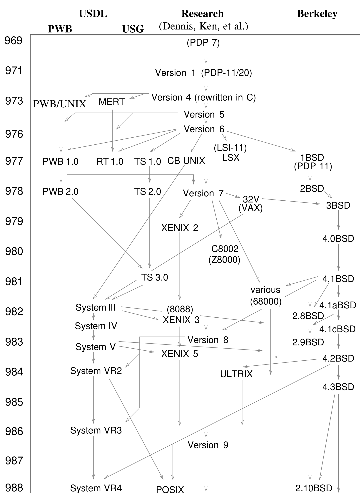

# 1.2 创世之初

有了 Space Travel，Ken 也就有了理由去实现那套他早先在 MULTICS 项目中设计和模拟过的理论文件系统。当然，要让机器真正有用，光有文件系统还不够。Ken 和朋友们写了第一个命令解释器（也就是 shell），还写了一些操作文件的简单工具。起初他们用 GE 系统给 PDP-7 交叉编译，可汇编器一写出来，这套系统基本上就能自给自足了。

到这一步，系统已经具备 UNIX 式的特征（比如用来支持多进程的 fork()），文件系统也和现代的 UNIX 文件系统非常接近：它使用 i 节点，还有支持目录和设备的特殊文件类型。这台 PDP-7 能同时支持两个用户。

“MULTICS”这个词其实是 MULTiplexed Information and Computing System（多路信息与计算系统）的缩写。1970 年，Brian Kernighan 开玩笑地把他们这套两人系统叫作“UNICS”，取“UNiplexed Information and Computing System”（单路信息与计算系统）之意——毕竟相比之下，MULTICS 显得像一个庞大得离谱的操作系统。（也有人说 MULTICS 的意思是“Many Unnecessarily Large Tables In Core Simultaneously”，还说 UNIX 不过是阉割版的 MULTICS。）不久，“UNICS”变成了“UNIX”，这个名字从此沿用下来。

计算机科学研究组对 PDP-7 并不完全满意。一来它是借来的机器；更重要的是，它算力太弱，根本撑不起计算服务的需求。于是小组又提出了一份方案，这次是要一台 PDP-11/20 来做文本处理研究。这份方案和以往几次的一个显著区别是：一台 PDP-11 的价格只有 DEC-10 那种系统的零头。方案比以前具体得多，而且明确指向“做一套文本处理系统”，管理层这才松口，买下了这台 PDP-11。

1970 年，UNIX 被移植到了 PDP-11/20 上。这可不是件轻松的差事——整个系统都是用汇编语言写的！小组把用汇编写的 roff（又叫 runoff，是 troff 的前身）从 PDP-7 移植到 11/20 上。有了它，再配上一个编辑器，似乎就足够称作一套文本处理系统了。

同一时期，贝尔实验室的专利办公室正在物色一套文本处理系统。它选中了小组这套基于 PDP-11/20 的 UNIX，而没有选商业系统。实验室的专利办公室由此成为 UNIX 的第一批正式用户。

这套第一个生产系统的一些特征值得一提：这台 PDP-11/20 上的 UNIX 没有内存保护，磁盘只有 0.5 MB，却要同时支持三个用户编辑和排版，外加原来的小组继续做 UNIX 开发。这套系统的文档被标为“第一版”，日期是 1971 年 11 月。

按照手册的版次（edition）来命名 UNIX 的发行版本，从此成了惯例。这里有个容易混淆的地方：版次也叫版本（version），两者说的是同一回事。比如 Version 7 就是第 7 版。

**图 1-1　UNIX 的主要演化步骤**

为便于检索，下表按原图整理各年份与版本名的对应关系。

**表 1-1　UNIX 主要演化步骤对照**

| 年份 | USDL / USG / PWB | Research（Dennis、Ken 等） | Berkeley |
| ---- | ---------------- | ------------------------- | -------- |
| 1969 | | （PDP-7） | |
| 1971 | | Version 1（PDP-11/20） | |
| 1973 | MERT、PWB/UNIX | Version 4（用 C 重写） | |
| 1975 | | Version 5、Version 6 | |
| 1976 | CB UNIX、LSX（LSI-11） | | 1BSD |
| 1977 | PWB 1.0、RT 1.0、TS 1.0（PDP-11） | | 2BSD |
| 1978 | PWB 2.0、TS 2.0 | Version 7、32V | 3BSD（VAX） |
| 1979 | XENIX 2 | | 4.0BSD |
| 1980 | TS 3.0（多种机型）、C8002（Z8000） | | 4.1BSD |
| 1981 | System III | | 4.1aBSD |
| 1982 | System IV、XENIX 3（8088） | | 2.8BSD |
| 1983 | System V、XENIX 5、ULTRIX | Version 8 | 2.9BSD、4.2BSD |
| 1984 | System VR2 | | 4.3BSD |
| 1986 | System VR3 | Version 9 | |
| 1987 | | | 2.10BSD |
| 1988 | System VR4 | | 4.4BSD、POSIX |

> **译注**：原图纵向按年代排列，横向分为 Research、USDL/USG/PWB 与 Berkeley 三支，另有 XENIX、ULTRIX 等旁支穿插其间；个别条目在下表中的横向位置与原图略有出入。

第二版于 1972 年发布，新增了管道这一特性。这一版还纳入了支持汇编之外语言的工作——尤其是 Ken 尝试用 NB 语言重写内核。

> **1972 年：数量爆炸**
>
> “UNIX 的安装数量已增长到 10 套，预计还会更多。”——《UNIX 程序员手册》第二版，1972 年 6 月

NB 是 B 语言的本地修改版（B 由 Ken 和 Dennis 设计），而 B 又源自 BCPL。BCPL（Basic CPL）是 Martin Richards 1967 年在剑桥设计的；CPL（Combined Programming Language）则是 1963 年剑桥与伦敦大学的联合项目。CPL 大量借鉴了 Algol 60（1960 年设计）的思想。

这些语言在控制结构上都和 C 有几分相像，但 B 和 BCPL 是“无类型”语言（虽说这个叫法并不恰当），因为它们只支持按“字”访问内存。NB 后来演化成了 C，而 C 迅速成为新工具和应用程序的首选语言。

MULTICS（用 PL/I 写成）的经验让 Ken 和 Dennis 明白：用高级语言写系统是值得的。于是他们一直朝这个方向努力。1973 年，C 增强了结构体和全局变量支持；至此，Ken 和 Dennis 成功用 C 重写了 UNIX 内核，shell 也从汇编改写成 C。系统的健壮性由此提高，编程和调试都容易多了。

这时大约有 25 套 UNIX 系统。实验室内部成立了一个 UNIX 系统组做内部支持。若干大学联系贝尔实验室并拿到了第四版的副本。各方签了不公开源码的协议，但此时还没有采用许可制度。磁带由 Ken 亲手制作，分文不取。第一批磁带寄给了纽约的哥伦比亚大学。

1974 年，Ken 和 Dennis 在《ACM 通讯》上发表论文介绍 UNIX 系统。当时这本期刊是计算机科学研究的头号刊物，这篇文章在学术界大大提升了人们对 UNIX 的兴趣。第五版正式向大学开放，“供教学使用”，价格只是象征性的——够覆盖一套磁带和手册的复制成本就行。许多大学把第五版用作教学辅助。

此时 Ken 和 Dennis 仍活跃在 UNIX 研究中，但他们始终刻意不作任何支持承诺。他们的小组后来被称作“Research”（实验室内部叫“1127”），他们的机器就叫 research。你可以通过 uucp 发 bug 报告，可以打电话，甚至可以直接走进他们办公室当面讨论 UNIX 问题。一般来说，第二天 bug 就修好了。

贝尔实验室还有另一个与 Research 不相干的小组，后来被称作 PWB，即 Programmer’s Workbench（程序员工作台）。PWB 组由 Rudd Canaday 领导，为一套 UNIX 版本提供支持，面向大型软件开发项目。PWB 系统的目标是：把 UNIX 的各项服务提供给那些未必关心 UNIX 研究的用户，当作一件现成的工具来用。小组投入了大量精力给 UNIX 内核“加硫化处理”（即加固），并让它支持大量用户。PWB 产出的两个特别有用的项目，一个是源码控制系统（SCCS），另一个是 RJE 系统——把 UNIX 用作访问实验室各大型机的统一前端。PWB 最终以 PWB/UNIX 1.0 的名义对外发放了许可。

在 PDP-11 上，UNIX 把 DEC 自家的操作系统挤得节节败退。虽然 UNIX 仍然无人提供支持，但它那些吸引人的长处足以压过种种问题。除了系统本身的特性，还有源码唾手可得、整套 UNIX 从头到尾都能读得懂；修改和扩展都很容易。这些特质让 UNIX 在同类操作系统中独树一帜。

1975 年，第六版 UNIX 发布。这是第一套在实验室外被广泛使用的 UNIX，AT&T（通过西方电气公司）开始向商业和政府用户发放许可。

Mike Lesk 发布了他的可移植 C 库。这个库是一组 I/O 例程，任何支持 C 编译器的机器都能实现，是让 C 具备产生可移植代码能力的关键一步。Dennis 后来重写了它，称之为标准 I/O 库（现在通常叫“stdio”）。

第一次 UNIX 用户会议在纽约市举行，由 Mel Ferentz 在纽约市立大学主办，40 人与会。此后会议每年举办两次，形式极其随意：想作报告的人举手，然后上去讲就是了。这些会议是交换 bug 报告、补丁和软件的最佳场合。每个人带两盘磁带——一盘装各自要送人的东西，一盘空白，用来装新东西。

Ferentz 办了一份叫 UNIX News 的通讯，免费寄给 UNIX 用户。直到贝尔实验室的一位代表登门，说他不能在名称里用“UNIX”，才改成了 ;login:。想要这份通讯的人越来越多，Ferentz 渐渐负担不起免费寄送。于是成立了一个组织来收会费，这就是 USENIX。USENIX 很快承担起其他职责，包括主办用户会议和分发软件。

在澳大利亚新南威尔士大学，John Lions 为一门操作系统课程准备了一套讲义。课程的主题是 UNIX 案例研究，讲义后来出版为《A Commentary on the UNIX Operating System》。讲义收录了完整的 V6 UNIX 内核源码，配上 Lions 逐行讲解式的评注——几乎每一行都有解释（包括那一行你“本不该试图弄懂”的代码）。

由于涉及大量源码，这本书的出版许可最终被收回。但在它还在印行的那段时间里，UNIX 变得远比从前容易理解。

1977 年，Interactive Systems 公司成为第一家向最终用户转售 UNIX 系统的公司。UNIX 终于成了一个有支持的产品。

同年，三个小组把 UNIX 移植到了不同的机器上：Steve Johnson 和 Dennis Ritchie 移植到 Interdata 8/32；Richard Miller 和澳大利亚卧龙岗大学的同事们移植到 Interdata 7/32；Tom Lyon 及普林斯顿的同事则移植到了 VM/370 环境。

每一次移植都堪称壮举。[^1] 这三台机器的内部结构和 PDP-11 都大不相同——而这正是移植的意义所在。操作系统从来不是为运行在多台计算机上而设计的；同样，计算机几乎总是为某一款操作系统量身打造。比如，如果计算机支持进程间的保护，那么操作系统就该按硬件设计的初衷来使用这项特性。

随着各家厂商为硬件配上种种花哨的选项，专门的、针对硬件优化过的操作系统也应运而生。为了驾驭这些不寻常的硬件、也为了极致速度，它们几乎清一色用汇编撰写。

Dennis 和 Ken 最大的突破，来自于他们意识到效率与通用性之间存在取舍：如果能在不推倒重来的前提下把操作系统移植到另一台计算机，只要不牺牲太多速度，就值得一试。做这个决定并不难——他们用 C 重写内核时，已经靠同样的理念成功过一次了。也就是说：若用汇编，UNIX 会更快、更小；但操作系统变得如此易于修改、理解和移植，值得用速度和内存来换。

很快，UNIX 又被移植到许多其他型号的 PDP-11 上。每一种机型都有自己的有趣特性，UNIX 能支持的硬件随之越来越复杂（浮点处理器、可写微码、内存管理与保护、指令与数据区分离……）。

不过，PDP-11 系列显然是围绕 16 位地址空间设计的，所有程序都被限制在 64 KB 以内。讽刺的是，这反而催生了小程序。有了支持进程协作的管道，再加上实现程序串联的 exec()，人们可以把若干小工具串起来搭出大型系统。这是 UNIX 编程的标志性风格——也许我们得谢谢 PDP-11 那点可怜的地址空间。

UNIX 还被移植到了 IBM Series 1 小型机上（有人觉得这好比把物质和反物质凑到一起）。Series 1 的字长和 PDP-11 一样是两个字节，但字节顺序是反的。结果机器第一次启动时，屏幕上打出的不是“UNIX”，而是“NUXI”。此后，“NUXI 问题”就用来指字节序问题。

1977 年，加州大学伯克利分校计算机科学系开始分发他们的 Pascal 解释器。随分发磁带附上的还有一批新驱动程序、内核补丁、ex 编辑器，以及一个新 shell（“Pascal shell”），它比 V6 的 shell 更好编程。这次分发被称为 1BSD（第一次伯克利软件分发）。

[^1]: 澳大利亚那次移植尤其棘手——悉尼的 PDP-11 和卧龙岗的 Interdata 相隔 100 公里！
