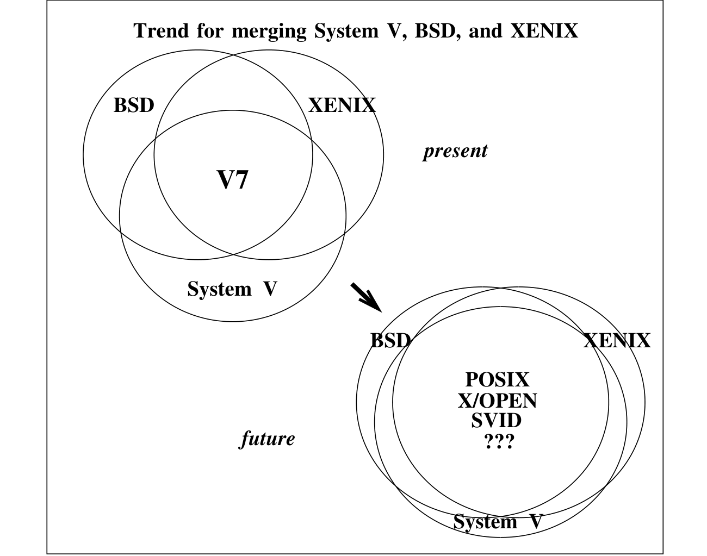

# 3.2 System V、BSD 与 XENIX 的融合

无论 UNIX 的定义是否被标准化，总会有一些产品成为事实标准。这种情况在 UNIX 界频繁发生，因为只有少数几家 UNIX 开发者，却要向大量 VAR 转售 UNIX。

最大的开发者显然是 AT&T，它做的一切都可能影响 UNIX 的未来。（其实处于这一位置的开发者还有几家，包括 IBM、Sun、Microsoft，以及 Berkeley 这类主要研究机构。）

> **译注**：原图为“System V、BSD 与 XENIX 的融合趋势”示意图。左侧“现在”，是 BSD、XENIX、V7、System V 四个相互交叠的圆，其中 V7 居中；右侧“未来”，BSD 与 XENIX 化作两个同心圆环，把 System V 套在正中，内圈标着 POSIX、X/OPEN、SVID 与 “???”，意指各标准逐渐收拢到 System V 周围。

AT&T 显然正努力把 XENIX 和 BSD 的重要特性并入 System V。它已与主要的 XENIX、BSD 厂商达成协议，要推出统一的 UNIX 版本。我们认为这番努力会成功：其他厂商（见讲现实世界的章节）早已这么做过，而且大受欢迎。一旦 AT&T 拿出统一的 UNIX 版本，它无疑会比任何其他 UNIX 更普及。
